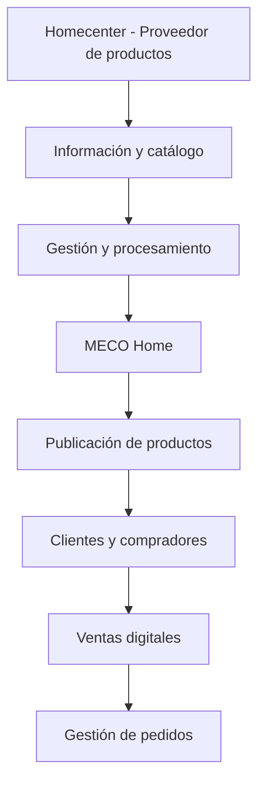

### Todo para construir, renovar y transformar tus espacios

**Construcción · Ferretería · Remodelación · Decoración · Hogar**

**Productos de Homecenter, con la calidad y el respaldo que conoces.**

[🌐 www.mecocenter.com](https://www.mecocenter.com)

---

## 🏠 Acerca de MECO Home

**MECO Home** es una plataforma digital especializada en la **publicación y venta de productos para construcción, ferretería, remodelación, decoración y mejoramiento del hogar**.

Nuestra plataforma comercializa productos provenientes de **Homecenter**, aprovechando la variedad de su catálogo y la calidad de los productos que ofrece para brindar una experiencia de compra digital moderna, práctica y accesible.

Nuestro propósito es facilitar el acceso a productos para el hogar y la construcción, centralizando su información y simplificando la búsqueda, selección y compra desde un único lugar.

**En MECO Home conectamos tus proyectos con los productos que necesitas para hacerlos realidad.**

---

## 🛒 ¿Qué ofrecemos?

MECO Home reúne productos de diferentes categorías disponibles en el catálogo de Homecenter.

- 🔨 **Ferretería y herramientas:** herramientas manuales, eléctricas, accesorios y suministros.
- 🧱 **Construcción:** materiales e insumos para proyectos de obra.
- 🎨 **Pinturas y acabados:** soluciones para renovar y transformar espacios.
- 💡 **Iluminación y electricidad:** productos y accesorios eléctricos.
- 🚿 **Baños y cocinas:** griferías, accesorios y equipamiento.
- 🛋️ **Hogar y decoración:** muebles, organización y decoración.
- 🌿 **Jardín y exteriores:** productos para espacios exteriores.
- 🔧 **Mantenimiento y remodelación:** soluciones para instalaciones y reparaciones.

Nuestra oferta comercial se construye a partir de productos de Homecenter, priorizando variedad, funcionalidad y calidad.

---

## 🚀 ¿Qué estamos construyendo?

Desarrollamos una plataforma tecnológica para facilitar la publicación y comercialización digital de productos.

- 🛍️ **Publicación de productos:** presentación organizada de productos provenientes de Homecenter.
- 📦 **Gestión de catálogos:** administración de categorías, características, precios, imágenes y especificaciones.
- 🔎 **Búsqueda de productos:** navegación intuitiva mediante categorías, filtros y buscadores.
- 🛒 **Ventas digitales:** funcionalidades para seleccionar y adquirir productos.
- 🔗 **Gestión de información comercial:** procesamiento de información de productos y referencias de Homecenter.
- 🔄 **Actualización de catálogos:** mecanismos para mantener organizada y actualizada la información publicada.
- 🖼️ **Contenido digital:** administración de imágenes, descripciones y fichas técnicas.
- ⚙️ **Automatización:** optimización de los procesos de publicación y gestión comercial.
- 📊 **Analítica:** herramientas para seguimiento de productos, publicaciones y ventas.
- 🌐 **Escalabilidad:** infraestructura preparada para ampliar el catálogo y las funcionalidades.

---

## 🌐 Nuestro modelo de operación

MECO Home aprovecha la oferta de productos de Homecenter para desarrollar una experiencia de publicación y venta digital propia.

Nuestro enfoque consiste en simplificar la publicación y comercialización de productos, permitiendo que los clientes encuentren soluciones para sus proyectos desde una plataforma digital centralizada.

---

## 🛠️ Áreas de desarrollo

| Área | Objetivo |
|------|----------|
| Publicación | Gestionar productos y contenido comercial |
| E-commerce | Facilitar la venta digital de productos |
| Catálogo | Organizar categorías, referencias y características |
| Gestión de datos | Procesar y normalizar información comercial |
| Actualización | Mantener precios y productos actualizados |
| Automatización | Optimizar procesos de publicación y operación |
| Experiencia de usuario | Crear interfaces intuitivas y modernas |
| Analítica | Facilitar el seguimiento de publicaciones y ventas |
| Infraestructura | Garantizar disponibilidad, seguridad y escalabilidad |

---

## 📂 Nuestros proyectos

En esta organización de GitHub encontrarás los repositorios tecnológicos relacionados con el desarrollo y evolución de **MECO Home**.

- Aplicaciones web de la plataforma.
- Servicios backend y APIs.
- Herramientas de publicación de productos.
- Procesamiento y normalización de catálogos.
- Administración de productos y categorías.
- Gestión de imágenes y fichas técnicas.
- Actualización de precios y disponibilidad.
- Automatización de procesos comerciales.
- Funcionalidades de comercio electrónico.
- Gestión de ventas y pedidos.
- Infraestructura y despliegues.
- Analítica y administración.
- Documentación técnica.

> Algunos repositorios pueden ser privados debido a que contienen componentes internos, configuraciones, integraciones o información propia de la plataforma.

---

## 🎯 Nuestra visión

Consolidar a **MECO Home** como una plataforma digital de referencia para la compra de productos de construcción, ferretería, remodelación, decoración y hogar.

Queremos facilitar el acceso a productos de calidad comercializados por Homecenter, ofreciendo una experiencia de compra sencilla, organizada y confiable.

Buscamos aprovechar la tecnología para acercar soluciones a nuestros clientes, simplificar procesos comerciales y hacer que desarrollar cualquier proyecto sea cada vez más fácil.

---

## 💡 Nuestros principios

- **Calidad:** priorizamos productos con características y estándares reconocidos.
- **Confianza:** buscamos ofrecer una experiencia de compra clara y confiable.
- **Innovación:** utilizamos tecnología para mejorar la comercialización digital.
- **Simplicidad:** facilitamos la búsqueda, selección y compra de productos.
- **Automatización:** optimizamos los procesos de publicación y administración.
- **Escalabilidad:** construimos una plataforma preparada para crecer.
- **Experiencia:** priorizamos interfaces rápidas, intuitivas y accesibles.
- **Seguridad:** protegemos la información y los procesos comerciales.

---

## 🔒 Seguridad

La seguridad es una prioridad en el desarrollo de **MECO Home**.

Si identificas una vulnerabilidad, evita publicarla directamente en un issue público. Comunícate de manera privada con nuestro equipo para que pueda ser revisada y gestionada responsablemente.

---

## 📬 Conoce MECO Home

Explora nuestra plataforma y encuentra productos para tus proyectos de construcción, remodelación y hogar.

### 🌐 [www.mecocenter.com](https://www.mecocenter.com)

---

### Calidad para tu hogar. Soluciones para tus proyectos.

 

  

**© 2026 MECO Home. Todos los derechos reservados.**

